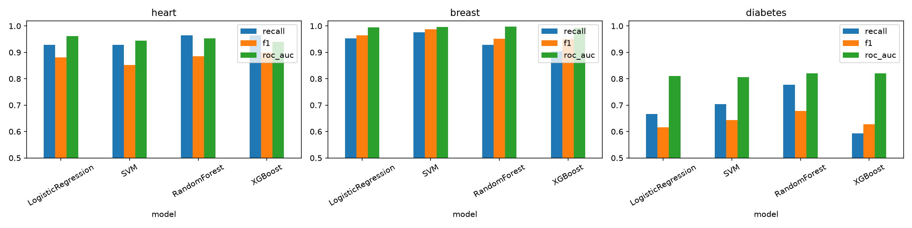
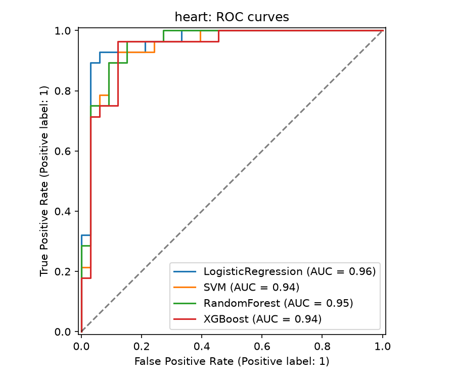
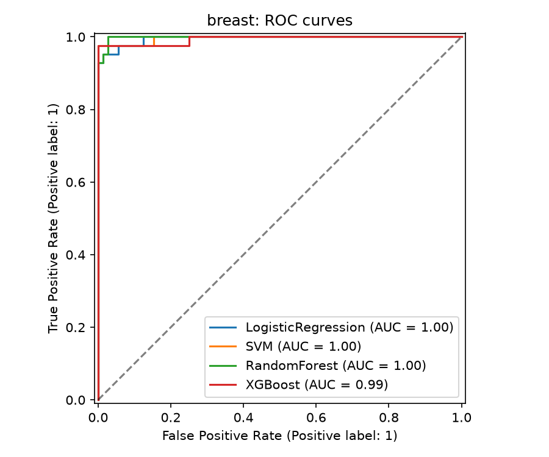
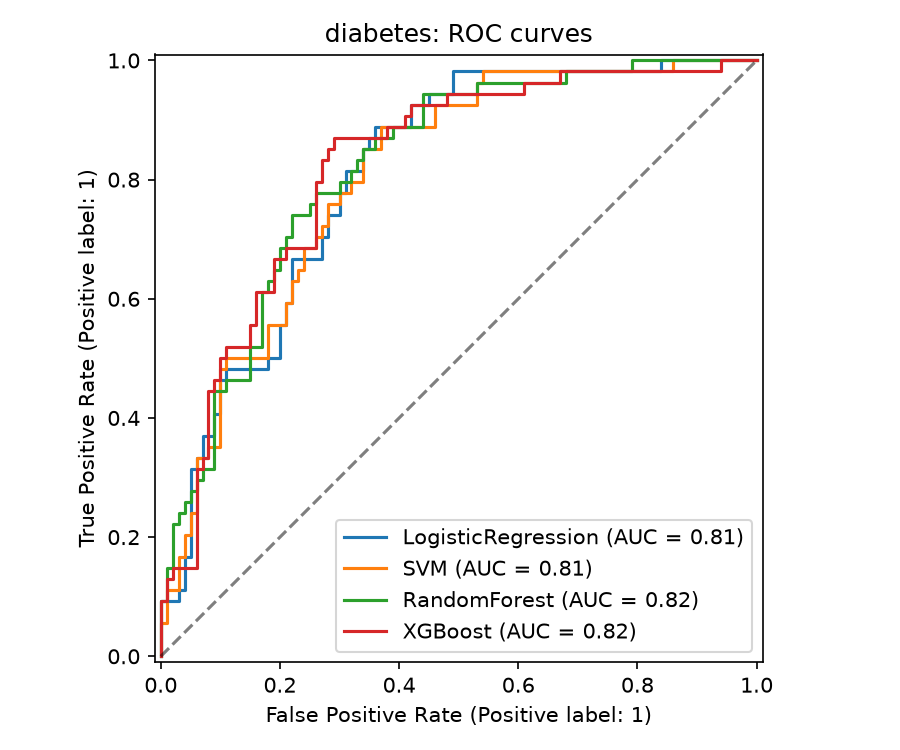
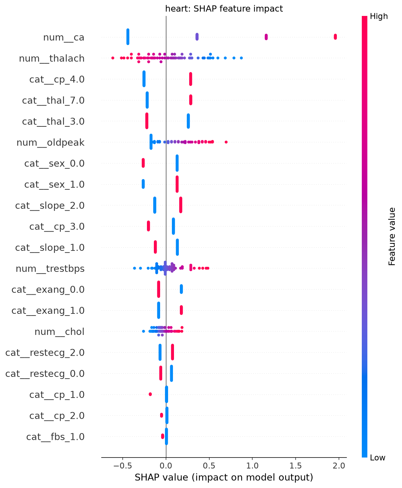
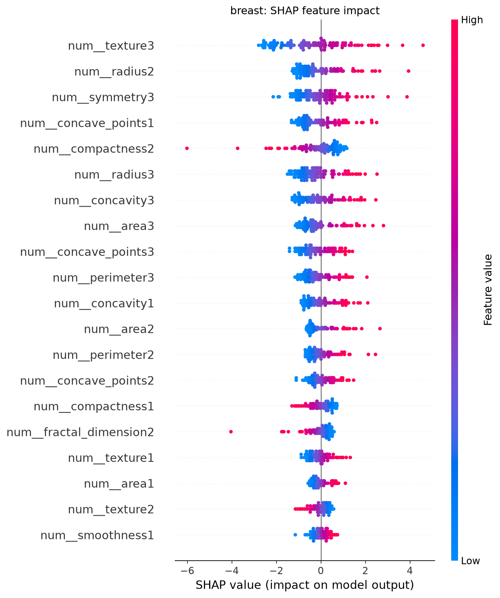
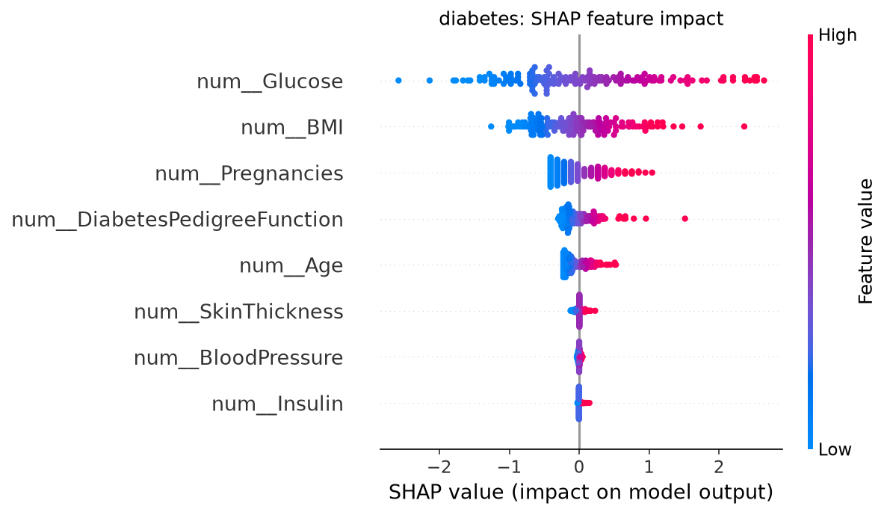

# 🩺 Disease Prediction from Medical Data


A machine learning pipeline that predicts the possibility of **heart disease**, **diabetes** and **breast cancer** from structured patient data. It compares four classifiers (Logistic Regression, SVM, Random Forest and XGBoost), explains their predictions with SHAP, and includes an interactive Streamlit demo.

> ⚠️ **Disclaimer:** This is an educational project. It is not a diagnostic tool and has not been clinically validated. Do not use it for medical decisions.


## Table of contents

- [Overview](#overview)
- [Datasets](#datasets)
- [Pipeline](#pipeline)
- [Results](#results)
- [Key findings](#key-findings)
- [Project structure](#project-structure)
- [Installation](#installation)
- [Usage](#usage)
- [Limitations](#limitations)
- [Tech stack](#tech-stack)
- [Data sources](#data-sources)
- [License](#license)
- [Author](#author)

## Overview

The goal is to apply classification techniques to structured medical datasets and predict whether a patient has a disease, using features such as age, blood pressure, cholesterol, glucose and cell measurements.

The project covers the full workflow: data loading and cleaning, exploratory data analysis, leak-free preprocessing, hyperparameter tuning with cross-validation, model comparison, interpretability with SHAP, and a web demo.

## Datasets

| Disease | Source | Rows | Features | Positive class |
|---|---|---|---|---|
| Heart disease | UCI Heart Disease (id 45, Cleveland data) | 303 | 13 | ~46% |
| Breast cancer | UCI Breast Cancer Wisconsin (Diagnostic) (id 17) | 569 | 30 | ~37% malignant |
| Diabetes | Pima Indians Diabetes (Kaggle copy of the UCI data) | 768 | 8 | ~35% |

Data notes:

- The heart target `num` (0 to 4) is converted to binary (0 = no disease, 1 = disease).
- In the diabetes data, zeros in `Glucose`, `BloodPressure`, `SkinThickness`, `Insulin` and `BMI` are impossible values, so they are treated as missing.

## Pipeline

1. **Load** the data (`src/data_loader.py`). UCI datasets are downloaded once and cached in `Data/Raw/`.
2. **Split** into stratified 80/20 train and test sets.
3. **Preprocess** inside a scikit-learn `Pipeline`, fitted on training data only so there is no data leakage:
   - Numeric features: median imputation, then standard scaling
   - Categorical features (heart only): most-frequent imputation, then one-hot encoding
4. **Train** four models with 5-fold stratified cross-validation and grid search (scoring: ROC-AUC): Logistic Regression, SVM, Random Forest and XGBoost.
5. **Evaluate** on the held-out test set with accuracy, precision, recall, F1, ROC-AUC, confusion matrices and ROC curves.
6. **Interpret** the models with feature importance and SHAP.
7. **Select** the saved best model for each dataset by cross-validated AUC, not by test score.

## Results

Test-set results for every model (the full table is in [`Reports/results.csv`](Reports/results.csv)):

| Dataset | Model | CV AUC | Accuracy | Precision | Recall | F1 | ROC-AUC |
|---|---|---|---|---|---|---|---|
| Heart | Logistic Regression | 0.911 | 0.885 | 0.839 | 0.929 | 0.881 | 0.961 |
| Heart | SVM | 0.902 | 0.852 | 0.788 | 0.929 | 0.852 | 0.945 |
| Heart | Random Forest | 0.899 | 0.885 | 0.818 | 0.964 | 0.885 | 0.952 |
| Heart | XGBoost | 0.882 | 0.902 | 0.844 | 0.964 | 0.900 | 0.939 |
| Breast cancer | Logistic Regression | 0.995 | 0.974 | 0.976 | 0.952 | 0.964 | 0.995 |
| Breast cancer | SVM | 0.995 | 0.991 | 1.000 | 0.976 | 0.988 | 0.996 |
| Breast cancer | Random Forest | 0.990 | 0.965 | 0.975 | 0.929 | 0.951 | 0.998 |
| Breast cancer | XGBoost | 0.995 | 0.965 | 1.000 | 0.905 | 0.950 | 0.994 |
| Diabetes | Logistic Regression | 0.845 | 0.708 | 0.571 | 0.667 | 0.615 | 0.810 |
| Diabetes | SVM | 0.844 | 0.727 | 0.594 | 0.704 | 0.644 | 0.806 |
| Diabetes | Random Forest | 0.839 | 0.740 | 0.600 | 0.778 | 0.677 | 0.821 |
| Diabetes | XGBoost | 0.833 | 0.753 | 0.667 | 0.593 | 0.627 | 0.821 |

### Model comparison



### ROC curves

| Heart | Breast cancer | Diabetes |
|---|---|---|
|  |  |  |

### Explainability (SHAP)

| Heart | Breast cancer | Diabetes |
|---|---|---|
|  |  |  |

## Key findings

- **Breast cancer is the easiest task.** All four models reach a CV AUC of about 0.99. SVM is best on the test set (accuracy 0.991, recall 0.976).
- **Heart disease** reaches a CV AUC of 0.88 to 0.91, with high recall (0.93 to 0.96) for every model. Logistic Regression has the best CV AUC.
- **Diabetes is the hardest task** (CV AUC about 0.84, accuracy 71% to 75%), partly because `Insulin` and `SkinThickness` have many missing values.
- **Recall is the priority metric.** In a medical setting, a missed patient is the costly error. At the default 0.5 threshold, diabetes recall is only 0.59 to 0.78. Lowering the decision threshold (chosen on cross-validated training predictions) raises recall at the cost of precision. See [`Notebooks/evaluation.ipynb`](Notebooks/evaluation.ipynb).
- **Small differences between models are within noise**, because the test sets are small.

## Project structure

```
disease_prediction/
├── app/
│   └── app.py                  # Streamlit demo
├── Data/
│   ├── Raw/                    # heart.csv, breast.csv, diabetes.csv
│   └── Processed/              # train/test splits
├── Models/                     # saved models (.joblib)
├── Notebooks/
│   ├── eda.ipynb               # exploratory data analysis
│   ├── preprocessing.ipynb     # cleaning and preprocessing steps
│   ├── modeling.ipynb          # baseline vs tuned models
│   └── evaluation.ipynb        # comparison, ROC, SHAP, threshold analysis
├── Reports/
│   ├── figures/                # plots
│   ├── screenshots/            # app screenshots
│   └── results.csv             # model comparison table
├── src/
│   ├── data_loader.py          # load datasets and project paths
│   ├── preprocessing.py        # imputation, scaling, encoding, split
│   ├── models.py               # model definitions and hyperparameter grids
│   ├── train.py                # train and tune all models
│   ├── evaluate.py             # metrics and plots
│   └── predict.py              # single-patient prediction
├── requirements.txt
├── LICENSE
└── README.md
```

## Installation

```bash
git clone https://github.com/YOUR-USERNAME/disease-prediction.git
cd disease-prediction

python -m venv venv
venv\Scripts\activate            # Windows
# source venv/bin/activate       # macOS / Linux

python -m pip install -r requirements.txt
```

Download `diabetes.csv` from Kaggle ([Pima Indians Diabetes Database](https://www.kaggle.com/datasets/uciml/pima-indians-diabetes-database)) and place it in `Data/Raw/`. The heart and breast cancer datasets are downloaded automatically on the first run.

## Usage

Run all commands from the project root.

```bash
python -m src.data_loader            # check that all three datasets load
python -m src.train                  # train and tune 4 models x 3 datasets
python -m src.predict                # example single-patient prediction
python -m streamlit run app/app.py   # launch the web demo
```

Training saves the models to `Models/`, the figures to `Reports/figures/` and the comparison table to `Reports/results.csv`.

### Predict for a single patient in Python

```python
from src.predict import predict_patient

patient = {"age": 58, "sex": 1, "cp": 4, "trestbps": 140, "chol": 260, "fbs": 0,
           "restecg": 0, "thalach": 120, "exang": 1, "oldpeak": 2.0,
           "slope": 2, "ca": 1, "thal": 7}

prediction, probability = predict_patient("heart", patient)
print(prediction, probability)
```

## Limitations

- The datasets and test sets are small (61 to 154 test patients), so one patient can change recall by several points and small model differences are not meaningful.
- Results come from a single train/test split. Repeated cross-validation would give more stable estimates.
- The datasets are not demographically diverse, so the models may not generalize to other populations.
- The models are not clinically validated and must not be used for real medical decisions.

## Tech stack

Python, pandas, NumPy, scikit-learn, XGBoost, SHAP, matplotlib, seaborn, Streamlit, Jupyter.

## Data sources

- **Heart Disease:** Janosi, Steinbrunn, Pfisterer, Detrano (1989). UCI Machine Learning Repository. https://doi.org/10.24432/C52P4X
- **Breast Cancer Wisconsin (Diagnostic):** Wolberg, Mangasarian, Street, Street (1993). UCI Machine Learning Repository. https://doi.org/10.24432/C5DW2B
- **Pima Indians Diabetes:** National Institute of Diabetes and Digestive and Kidney Diseases, via the UCI repository and Kaggle.

## License

This project is licensed under the MIT License. See the [LICENSE](LICENSE) file for details.

## Author

Adarsh kasaudhan
[GitHub](https://github.com/adarshkasaudhan774-spec) · [LinkedIn](https://www.linkedin.com/in/adarsh-kasaudhan-992243378/) · adarshkasaudhan774@gmail.com
